# Veloport

**Интернет-магазин велосипедов и спортивного инвентаря** на Django — монолит с
чистой модульной архитектурой и заделом под вынос в микросервисы.

Полноценный e-commerce с фокусом на удобство: умный подбор велосипеда, мощный
фасетный фильтр, сравнение моделей, честное наличие по магазинам с онлайн-резервом,
веломастерская, trade-in, промокоды, бонусы и аналитический дашборд.


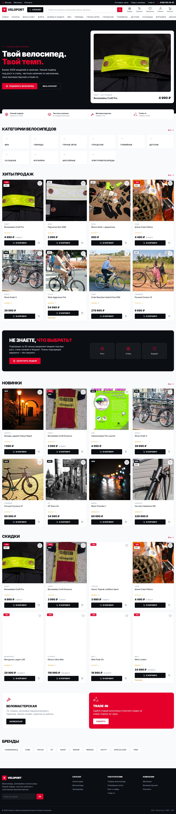

---

## Возможности проекта

**Витрина и покупка**
- Каталог с деревом категорий (MPTT), брендами и карточками товаров
- **Умный подборщик** велосипеда: рост → стиль → бюджет → модели + ростовка
- **Фасетный фильтр** на HTMX (колёса, рама, тормоза, амортизация, ростовка) — без перезагрузок
- **Живой поиск** с автоподсказками в шапке
- **Сравнение** моделей с **подсветкой отличий**
- Корзина на сессии (HTMX) + оформление заказа
- Оплата **ЮKassa** (+ demo-режим), **промокоды**, **система бонусных баллов**
- **Избранное**, недавно просмотренные

**Доверие и сервис**
- Отзывы (плюсы/минусы/рейтинг) с сортировкой, пагинацией и оценкой «полезно»
- Вопросы-ответы к товару
- **Наличие по магазинам** + бесплатный онлайн-резерв
- «Сообщить о поступлении» + **email-уведомления** (заказ, поступление, сервис)
- **Веломастерская** (запись онлайн) и **Trade-in**
- **Отслеживание заказа** по номеру + телефону

**Кабинет и управление**
- Личный кабинет покупателя: заказы, бонусы, **сохранённые адреса**, подписки
- **Аналитический дашборд** (выручка, заказы, топ-товары, склад)
- Удобная **админка с использованием библиотеки Jazzmin** с превью фото и цветными статусами

**Техническая часть**
- Server-side рендеринг + HTMX + Alpine.js + Tailwind CSS
- REST API на DRF, SEO (sitemap.xml, robots.txt, OpenGraph)
- 68 автотестов (pytest), Docker + PostgreSQL, CI (GitHub Actions)

---

## Скриншоты интерфейса

### Каталог с фасетным фильтром
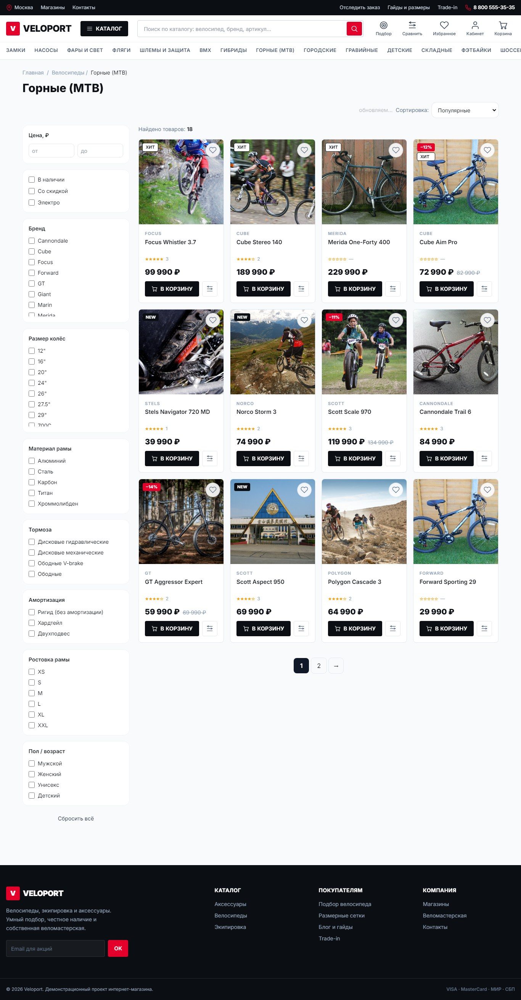

### Карточка товара
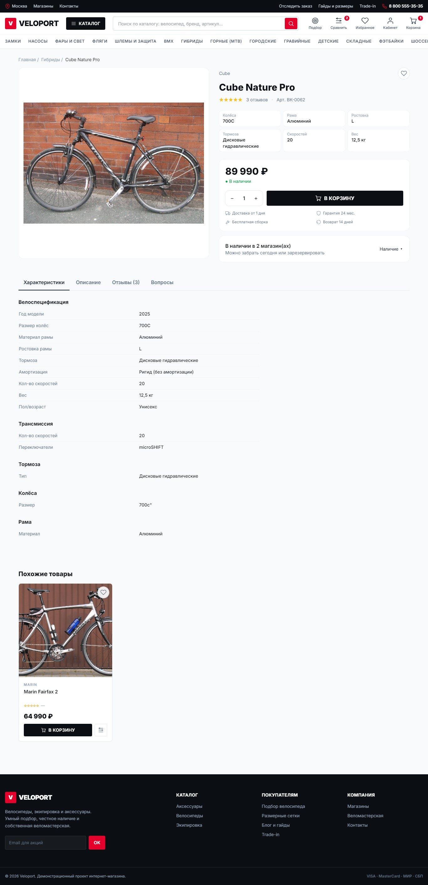

### Умный подбор велосипеда
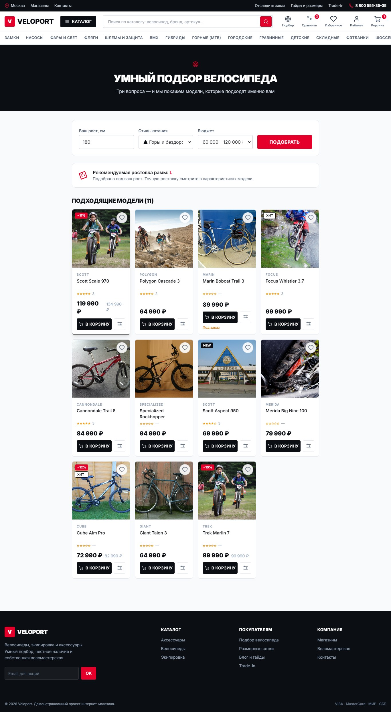

### Сравнение с подсветкой отличий
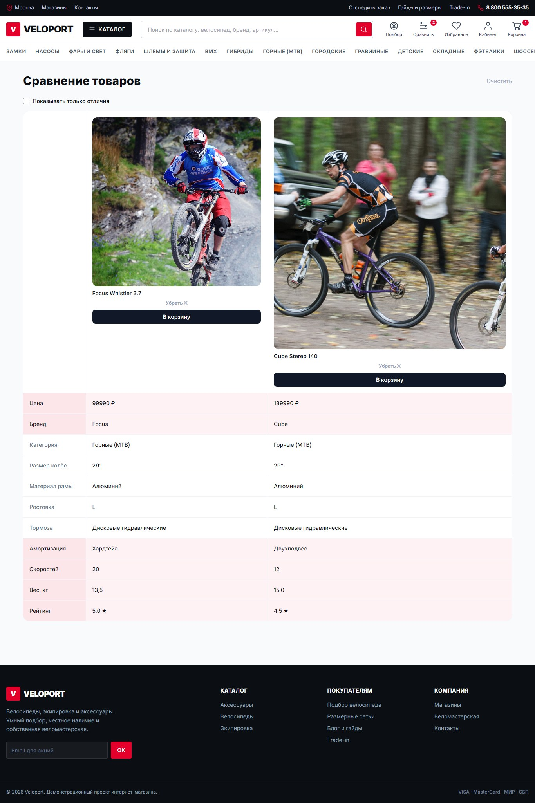

### Корзина и оформление заказа
| Корзина | Оформление |
| :---: | :---: |
| 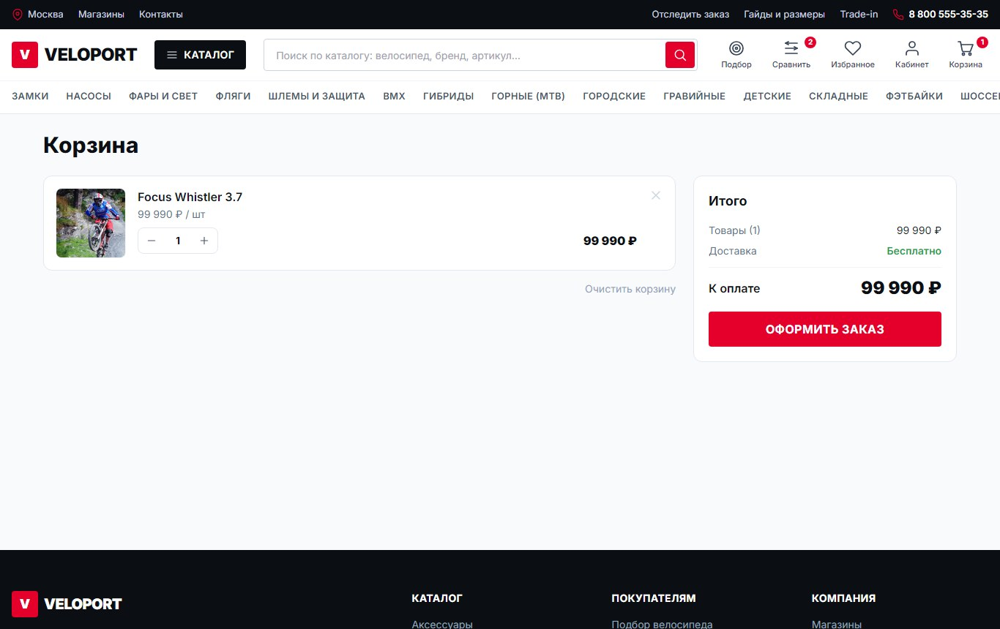 | 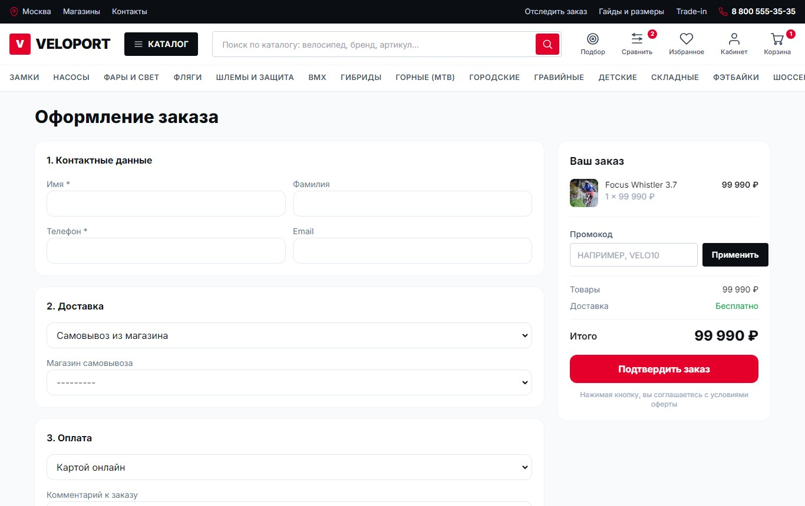 |

### Избранное · Магазины · Веломастерская · Trade-in
| Избранное | Магазины |
| :---: | :---: |
| 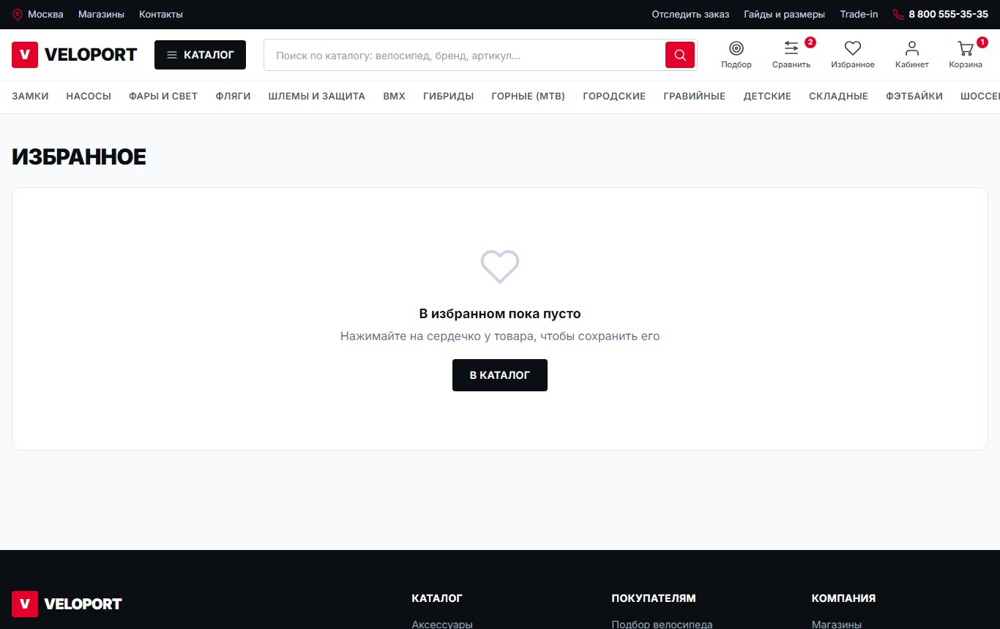 | 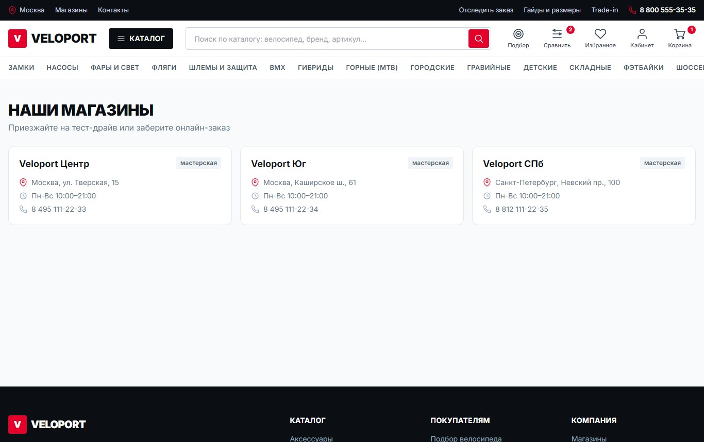 |
| 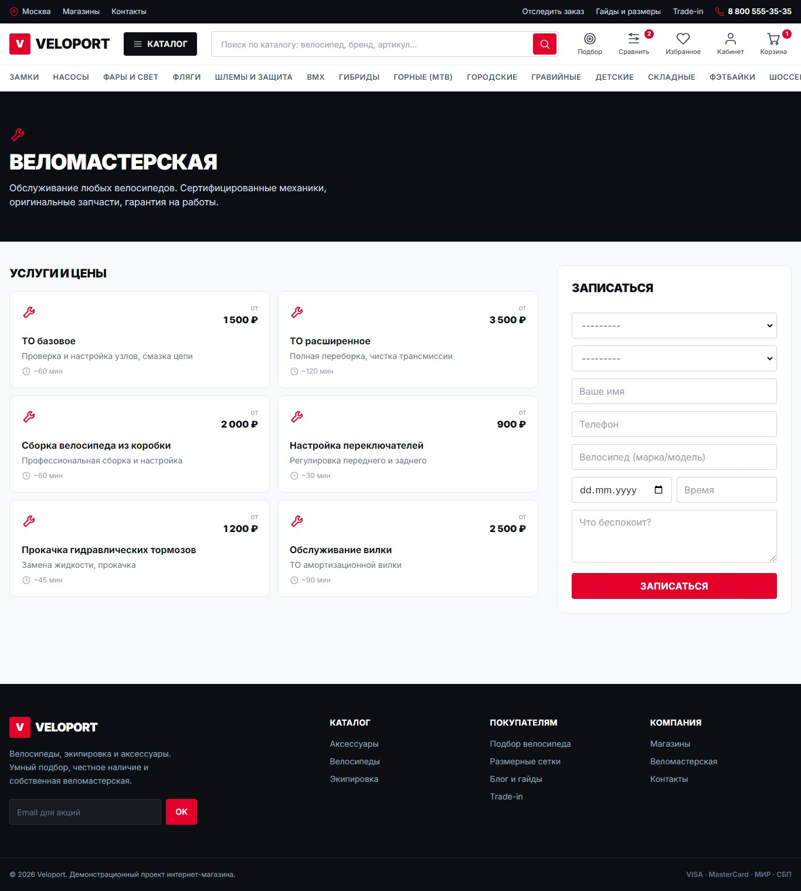 | 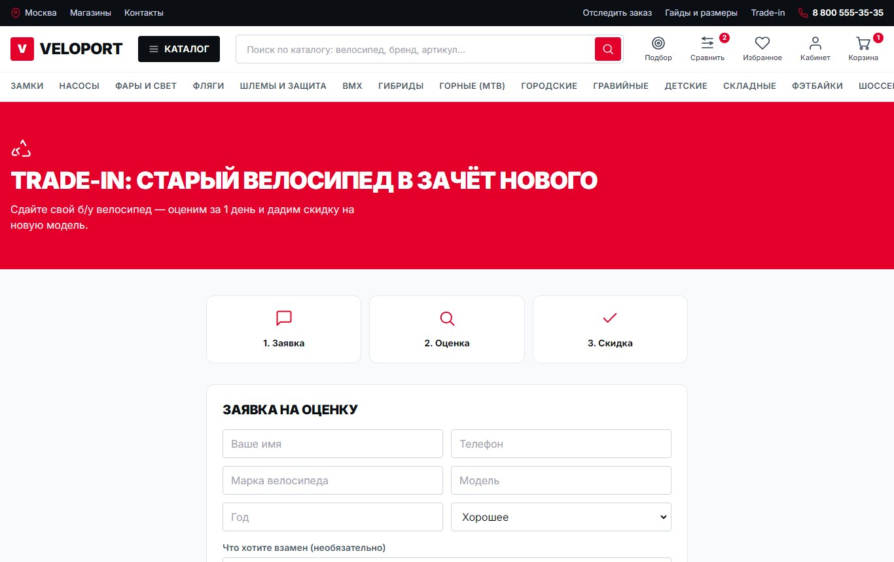 |

### Гайды и размерные сетки
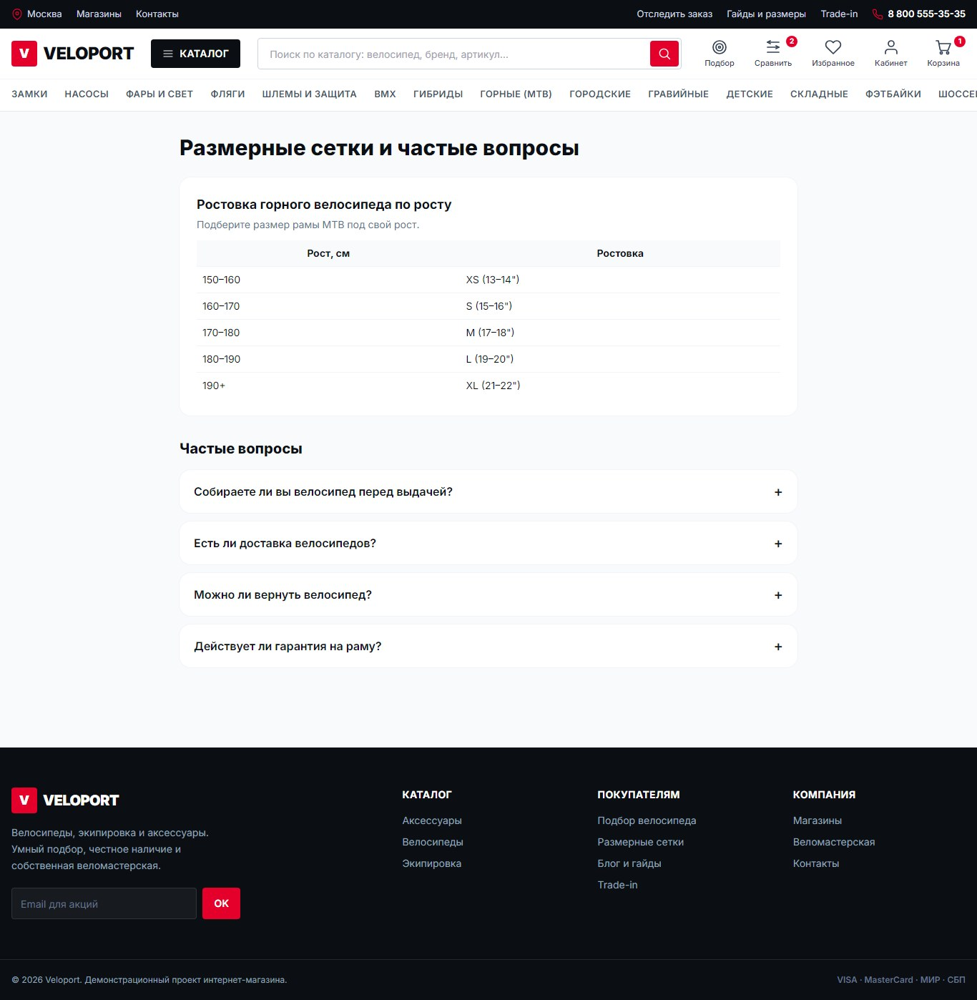

### Аналитический дашборд
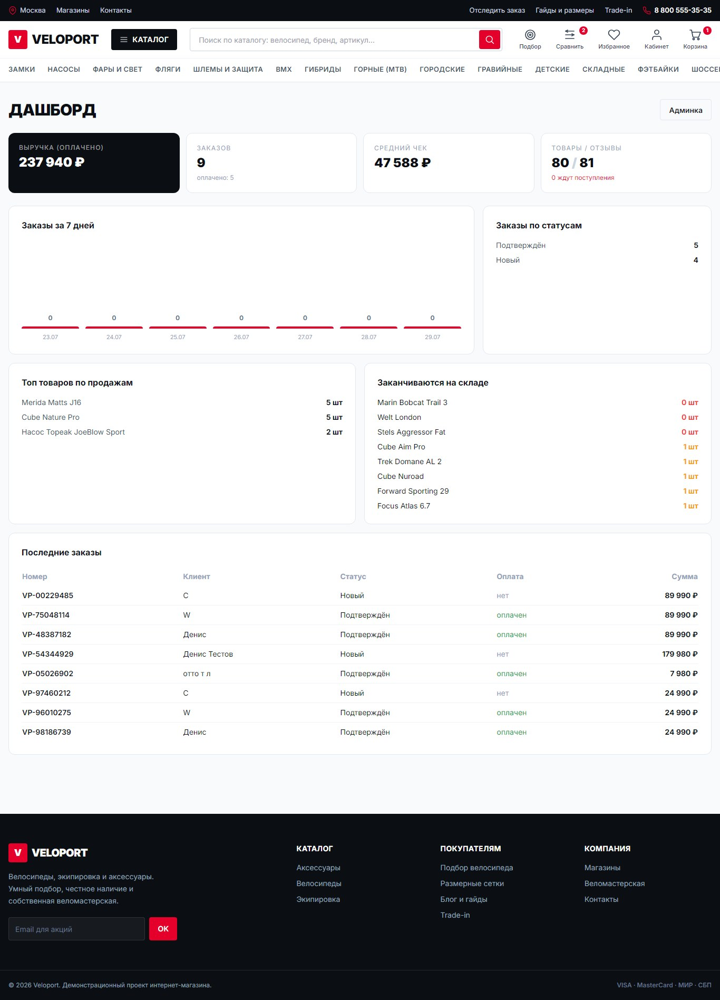

### Админка (Jazzmin)
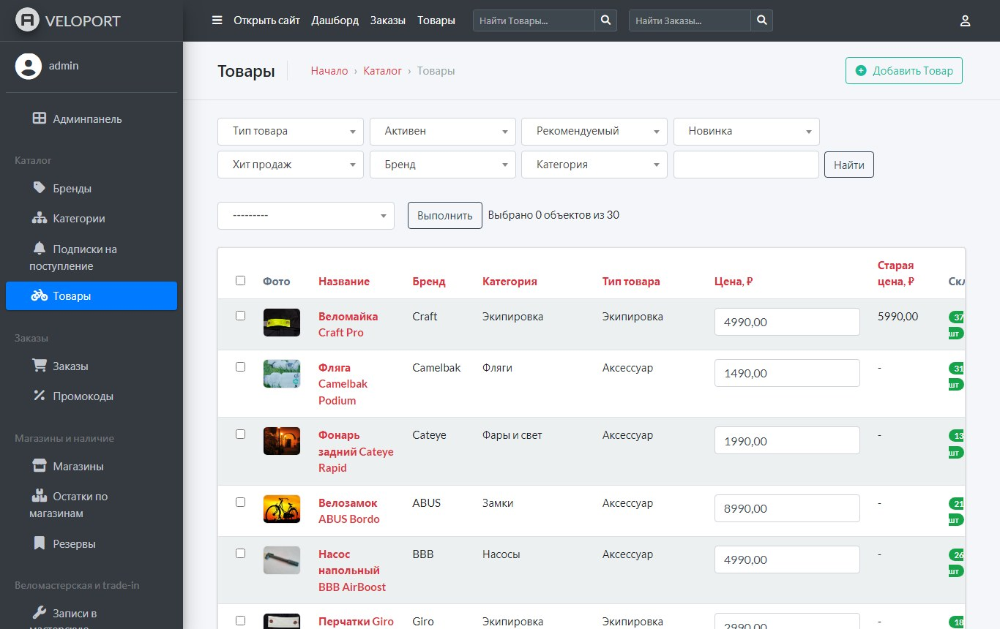

---

## Стэк технологмй

Python 3.12 · Django 4.2 · Django REST Framework · HTMX · Alpine.js ·
Tailwind CSS · django-mptt · Pillow · YooKassa · django-jazzmin ·
PostgreSQL / SQLite · Gunicorn · WhiteNoise · pytest · Docker

---

## Структура

```
veloport/
├── config/               # настройки, корневые urls, wsgi
├── apps/
│   ├── core/             # главная, подбор, сравнение, избранное, дашборд, email, SEO
│   ├── accounts/         # пользователь, профиль, адреса, бонусы
│   ├── catalog/          # категории, бренды, товары, велоспеки, поиск, API, фото
│   ├── cart/             # корзина на сессии
│   ├── orders/           # заказы, оформление, оплата, промокоды, отслеживание
│   ├── reviews/          # отзывы, Q&A, оценка «полезно»
│   ├── stores/           # магазины, остатки, резерв
│   ├── service/          # веломастерская и trade-in
│   └── content/          # блог, гайды, страницы, FAQ, размерные сетки
├── templates/            # шаблоны (base + по приложениям)
├── docs/screenshots/     # скриншоты
└── manage.py
```

---

## Быстрый старт (Quick start) 

```bash
python -m venv .venv
.venv\Scripts\activate            # Windows  (source .venv/bin/activate — Linux/macOS)
pip install -r requirements.txt
copy .env.example .env

python manage.py migrate
python manage.py seed_demo         # категории, бренды, 80 товаров, магазины, промокоды
python manage.py fetch_photos      # реальные фото товаров (свободная лицензия)
python manage.py runserver
```

Сайт: http://127.0.0.1:8000/ · Админка: http://127.0.0.1:8000/admin/ (**admin / admin**)
Демо-промокоды: `VELO10` (−10%), `SPRING1500` (−1500 ₽ от 30 000).

---

## Docker

```bash
docker compose up -d --build       # web (gunicorn) + PostgreSQL, авто-миграции, seed и фото
```

Сайт на http://localhost:8000/. Остановить — `docker compose down` (данные в томе `pgdata`).

---

## Тесты (tests)

```bash
pytest                 # 68 тестов
pytest --cov=apps      # с покрытием
```

Покрыты каталог, корзина, заказы и оплата, промокоды и бонусы, отзывы, магазины,
сервис, подбор, сравнение, избранное, аккаунты, email-уведомления, дашборд.

---

## API

| Метод | Эндпоинт | Описание |
| --- | --- | --- |
| GET | `/api/products/` | Список товаров (`?category=`, `?q=`) |
| GET | `/api/products/<slug>/` | Товар |
| GET | `/api/categories/` | Категории |
| GET | `/sitemap.xml` · `/robots.txt` | SEO |

---

## Оплата (ЮKassa)

По умолчанию — **demo-режим** (имитация оплаты). Для реальной оплаты задайте в `.env`:

```env
YOOKASSA_SHOP_ID=...
YOOKASSA_SECRET_KEY=...
```

Вебхук уведомлений: `POST /order/webhook/yookassa/` (событие `payment.succeeded`).

---

## Дорожная карта

- [x] Каталог, карточка, корзина, заказ, оплата ЮKassa (+ demo)
- [x] Подбор, фасетный фильтр, сравнение с подсветкой отличий
- [x] Отзывы/Q&A, магазины, резерв, веломастерская, trade-in
- [x] Избранное, живой поиск, промокоды, бонусы, отслеживание
- [x] Email-уведомления, кабинет с адресами, админ-дашборд
- [x] Реальные фото товаров, SEO, тесты, Docker, CI
- [ ] Полнотекстовый поиск (Meilisearch)
- [ ] Вынос поиска/оплаты в отдельные сервисы

---

## О проекте (about)

Проект выполнен в учебных целях для портфолио. Он демонстрирует полный цикл разработки e-commerce на Django:
от моделей и бизнес-логики до тестов, контейнеризации и деплоя.
